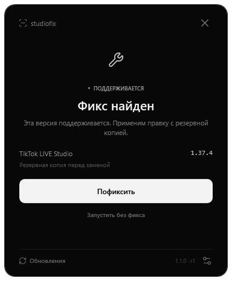

# StudioFix

Небольшое тёмное приложение для проверки сетевого фикса и запуска TikTok LIVE Studio.

**[Скачать установщик для Windows](https://github.com/BANANCHIKIREAL/StudioFix/releases/latest/download/StudioFix-Setup.exe)** · [Все версии](https://github.com/BANANCHIKIREAL/StudioFix/releases) · [Сообщить об ошибке](https://github.com/BANANCHIKIREAL/StudioFix/issues/new/choose)



## Как пользоваться

1. Скачай `StudioFix-Setup.exe` по ссылке выше и установи.
2. Открой собственный ярлык **StudioFix** на рабочем столе или в меню «Пуск».
3. Программа найдёт Studio и проверит версию. Полностью закрой Studio перед изменением файлов.
4. Если фикс доступен, нажми белую кнопку **Пофиксить**. Перед заменой сохраняется резервная копия.
5. Когда появится **Запустить**, нажми её, чтобы открыть Studio. Уже установленная правка определяется при повторном открытии.

Обычный ярлык **TikTok LIVE Studio** открывает саму Studio. StudioFix не запускается вместе с Windows и не перехватывает запуск Studio.

Для неподдерживаемого кода доступна серая ссылка **Запустить без фикса**. Если правка StudioFix уже применена и её резервная копия прошла проверку, эта ссылка сначала возвращает оригинал. Применить фикс снова можно при следующем открытии StudioFix.

## Если Studio не найдена

Нажми **Выбрать папку** или **Настройки → Папка Studio**. Можно вставить путь к папке, EXE или обычному ярлыку. Поддерживаются кавычки и переменные Windows, например `%LOCALAPPDATA%`.

Где взять путь: правой кнопкой по обычному ярлыку **TikTok LIVE Studio → Свойства → Объект**. Скопируй весь путь в StudioFix и нажми **Проверить путь**. Также можно нажать **Расположение файла** и скопировать адрес папки. Частый вариант: `C:\Program Files\TikTok LIVE Studio`.

Автоматический поиск использует реестр установленных программ, App Paths, рабочий стол и меню «Пуск», стандартные папки, сохранённый путь и доступные сведения запущенных процессов. Есть **Расширенный поиск по дискам**. Активная версия читается из `launcher_config.json.cur_path`, поэтому сохранённый путь следует за обновлением установщика Studio. Реализация: [Discovery.cs](src/Discovery.cs), [Ui.cs](src/Ui.cs).

## Поддержка версий

Встроены правила для **1.36.6** и **1.37.4**. Успешный эфир после этих правок подтверждён автором на его компьютере в ходе подготовки проекта; независимая проверка на всех компьютерах не проводилась. Контрольные суммы исходного и изменённого `main.js` записаны в [каталоге правил](publisher/studio-fix-rules.json).

Для другой версии приложение анализирует знакомую структуру сетевого кода. Если она распознана, окно показывает **Возможный фикс** и сообщает, что сборку нужно проверить в эфире. Если структура не распознана, автоматическая замена не выполняется. Реализация: [PatchEngine.cs](src/PatchEngine.cs).

Это неофициальный проект. Он не выдаёт доступ к LIVE и не меняет разрешения аккаунта. Исправление всех причин сообщения «Проверьте подключение к Интернету» не подтверждено.

## Обновления

Адрес этого репозитория уже встроен в приложение. При открытии через собственный ярлык StudioFix проверяет последний публичный GitHub Release; проверку можно отключить в настройках. Кнопка **Обновления** позволяет проверить вручную.

- **Правила фикса** загружаются отдельно, проходят проверку подписи и сохраняются без переустановки приложения.
- **Новая версия приложения** показывает небольшое тёмное окно. Нажми **Обновить приложение**, чтобы скачать проверенный установщик; либо **Позже**, чтобы продолжить с текущей версией.
- Подпись RSA/SHA-256 проверяется встроенным открытым ключом. Перед запуском установщика проверяются размер и SHA-256 из подписанного описания. Переход на старую версию не предлагается.
- При недоступном GitHub остаются встроенные или ранее проверенные правила. Сканирование Studio начинается без ожидания сети.

Реализация и проверяемые ограничения: [AppUpdates.cs](src/AppUpdates.cs), [RuleUpdates.cs](src/RuleUpdates.cs), [тесты обновлений](tests/AppUpdatesTests.cs). Используется [GitHub API последнего Release](https://docs.github.com/en/rest/releases/releases#get-the-latest-release).

## Установка и удаление

Приложение предназначено для **Windows 10/11 x64 с .NET Framework 4.8 или новее**. Установщик проверяет runtime по [методу Microsoft](https://learn.microsoft.com/en-us/dotnet/framework/install/how-to-determine-which-versions-are-installed#minimum-version), при отсутствии предлагает открыть официальную страницу загрузки.

Установка выполняется для текущего пользователя в `%LOCALAPPDATA%\Programs\StudioFix`. Настройки и журнал находятся в `%LOCALAPPDATA%\StudioFixLauncher`. Ярлыки создаются только для StudioFix. Удаление доступно в **Параметры Windows → Приложения → StudioFix**. Удаление приложения сохраняет настройки и резервные копии фикса; вернуть оригинальный файл Studio можно перед удалением в настройках StudioFix.

Проверка и обычное окно используют права текущего пользователя. Для правки в защищённой папке `Program Files` Windows может запросить повышение прав у помощника. Установщик создан с [Inno Setup](https://jrsoftware.org/isinfo.php), с [`PrivilegesRequired=lowest`](https://jrsoftware.org/ishelp/topic_setup_privilegesrequired.htm). Исходник: [StudioFix.iss](installer/StudioFix.iss).

Первый публичный EXE не подписан сертификатом Authenticode; RSA-подпись обновлений является отдельным механизмом и не заменяет подпись издателя Windows.

Для старых тестовых сборок сохранена только функция восстановления ранее подключённых ярлыков Studio. Доступные записи восстанавливаются при установке/открытии; если общий ярлык требует прав, в настройках есть **Восстановить старый ярлык Studio**. Новые подключения к ярлыку Studio отсутствуют. Реализация: [Integration.cs](src/Integration.cs).

## Сборка

Нужны Windows x64, .NET Framework 4.8, .NET SDK с компилятором C# и PowerShell 7. NuGet-пакеты для приложения не используются.

```powershell
./build.ps1
./build.ps1 -Tests
./build/StudioFix.Tests.exe --app-updates-only ./build/update-tests
```

Результат: `build/StudioFix.exe`. Для установщика нужен **Inno Setup 6.6 или новее**. Проект лицензирован MIT; лицензия иконок Lucide — отдельно в [LUCIDE-LICENSE.txt](publisher/LUCIDE-LICENSE.txt). Точные исходники иконок указаны в [icon-sources.json](publisher/icon-sources.json).

Выполненные проверки перечислены в [отчёте](docs/VERIFICATION.md). Полная проверка правок использует локальные оригинальные файлы `main.js` обеих сборок и тестовый EXE, который не запускает настоящую Studio. Подготовь JSON: `{"1.36.6":"C:\\fixtures\\1.36.6\\main.js","1.37.4":"C:\\fixtures\\1.37.4\\main.js"}`. Затем:

```powershell
./build/StudioFix.Tests.exe ./build/fixtures ./original-js-paths.json ./build/FixtureStudio.exe
```

Файлы TikTok в репозитории и релизах не распространяются. [CI](.github/workflows/build.yml) собирает EXE, проверяет обновления на имитированных ответах GitHub и рендерит интерфейс; он не заменяет проверку эфира на новой версии Studio.

## Для автора: выпустить обновление

Закрытый ключ подписания хранится у владельца проекта отдельно от репозитория. Не помещай его в Git, Release или публичные артефакты. Уже выпущенное приложение принимает подписи только соответствующего встроенному ключу автора.

1. Для новой версии Studio сначала проверь правку и реальный эфир. Экспорт распознанного кода сам по себе не подтверждает успешный эфир.
2. Добавь правило и подпиши каталог:

```powershell
./publisher/Add-Rule.ps1 -StudioPath 'C:\Program Files\TikTok LIVE Studio' -LauncherPath './build/StudioFix.exe'
./publisher/Sign-Rules.ps1 -PrivateKeyPath 'C:\private\private-key.xml'
```

3. Увеличь `BuildInfo.AppVersion` в [Models.cs](src/Models.cs), внеси запись в `CHANGELOG.md`, собери и проверь приложение. Даже при выпуске только новых правил используй новый номер приложения для этого сценария публикации.
4. Закоммить изменения и отправь их в `main`. Подготовь отдельный Markdown-файл с заметками к релизу за пределами рабочей папки Git или в уже закоммиченном файле.
5. Вызови:

```powershell
./publisher/Publish-Release.ps1 `
  -PrivateKeyPath 'C:\private\private-key.xml' `
  -CompilerPath 'C:\Program Files (x86)\Inno Setup 6\ISCC.exe' `
  -NotesFile 'C:\release-notes.md' `
  -Summary 'Короткое описание для окна обновления'
```

Скрипт создаёт черновик, загружает установщик, переносной EXE, подписанный каталог, подписанное описание приложения и контрольные суммы, затем публикует готовый выпуск. Если загрузка не завершилась, выпуск остаётся черновиком. После публикации подписчики увидят новую версию при следующей проверке в приложении. Прямая ссылка **Скачать установщик** всегда ведёт на последний опубликованный выпуск.

Чтобы только собрать файлы и проверить их до публикации, используй [Build-Release.ps1](publisher/Build-Release.ps1) с теми же путями к ключу и ISCC. Закрытый ключ не загружается на GitHub; он используется локально для подписания.
